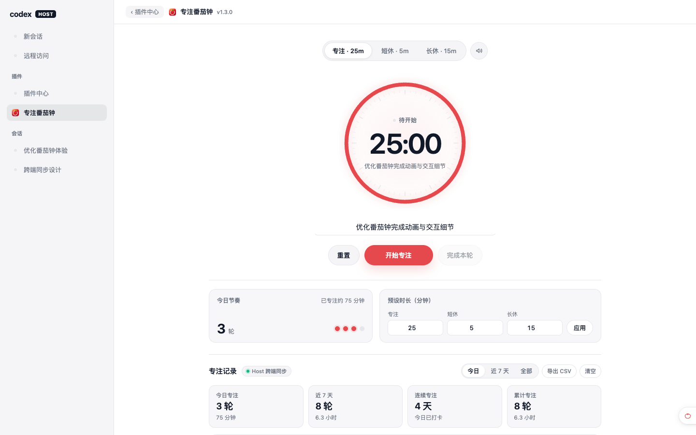
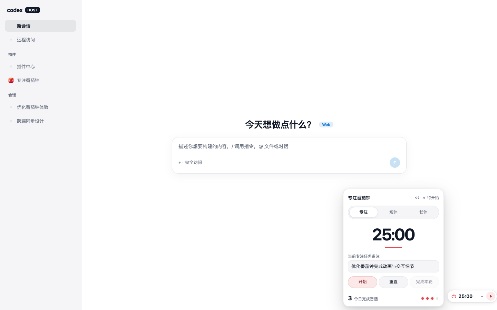
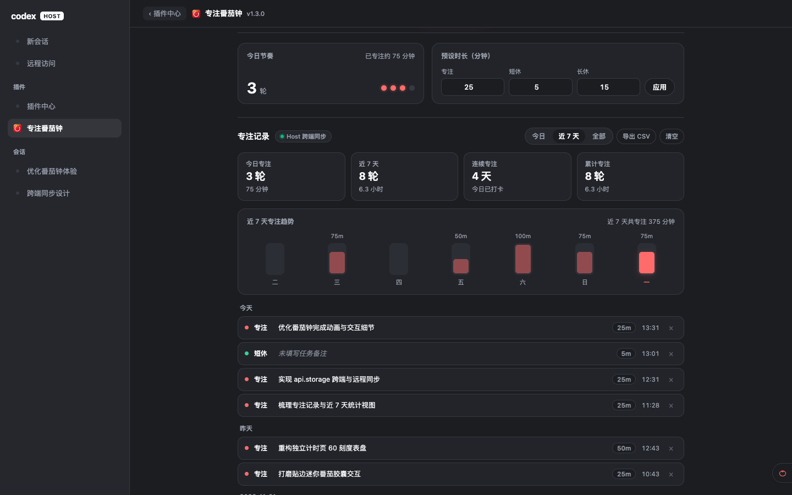

  
  <h1>Focus Pomodoro / 专注番茄钟</h1>
  

    A calm, zero-backend Pomodoro extension for <strong>CodexHost Desktop</strong> &amp; <strong>CH Web</strong> — featuring a compact edge-docking capsule, centered completion celebration animation, inline custom duration editing, and cross-device Host-synced focus history.
  

  

    为 <strong>CodexHost Desktop</strong> 与 <strong>CH Web</strong> 打造的轻量专注番茄钟扩展：支持迷你贴边悬浮胶囊、倒计时完成庆祝动画、点击时间行内自定义时长，以及基于共享 Host 跨端与远程实时同步的专注历史统计，<strong>纯前端零后台进程</strong>。
  

---

## 简体中文

### 核心特性

- **倒计时完成庆祝动画与柔和提示音**
  - 每轮专注或休息归零时，在屏幕中央弹出磨砂庆祝卡片（弹性入场、3 层扩散脉冲光环、12 颗几何微粒绽放与 SVG 描边徽章，浅/深色及各模式自动适配）。
  - 内置纯浏览器 Web Audio 柔和和弦提示音（无需外部音频文件），可在插件设置、浮窗顶部或独立页顶栏一键静音。
  - 智能推荐下一轮操作：第 1–3 轮专注后推荐短休，满 4 轮推荐长休，休息结束一键回到专注；支持点击遮罩、按钮或按 `Esc` 随时关闭。
- **迷你贴边胶囊与快捷浮窗**
  - 可自由拖动到窗口任意位置并吸附左右边缘：**未使用时自动深收为仅 `36×36px` 的迷你番茄小耳朵**，不遮挡对话内容；悬停顺滑探出完整胶囊，计时中保持半隐展示实时倒计时。
  - 点击胶囊就近弹出轻量控制浮窗，无需离开当前对话即可切模式、编辑专注任务备注、开关提示音或启停计时。
- **点击时间原位自定义时长**
  - 在「待开始」或「本轮已完成」状态下，直接点击浮窗或表盘中央的 `25:00` 即可原位输入本次自定义时长：支持纯分钟（如 `15`、`0.5`）或 `分:秒`（如 `12:30`、`0:10`），不覆盖默认预设；按 `Esc` 仅取消编辑，点「重置」恢复预设。
- **纯前端零后台 · 跨端与远程同步 & 专注统计**
  - 倒计时状态、任务备注与历史完成记录均持久化在 CodexHost 共享 Host 存储（`api.storage`）中，**零常驻 Node 进程、零额外内存开销**。
  - 本机 Codex Desktop、本机 Web 与**远程访问的 CH Web** 实时互通同步。
  - 独立计时页内置「专注记录」面板：展示今日 / 近 7 天 / 连续打卡天数 / 累计统计、近 7 天专注趋势柱状图、按日分组明细、单条删除及一键导出 CSV。

### 界面预览

#### 1. 时间到 · 屏幕中央完成庆祝动画

#### 2. 对话页悬浮胶囊与快捷控制浮窗

#### 3. 专注记录、近 7 天趋势与深色主题

### 安装与使用

1. **市场安装（推荐）**：打开 CodexHost「设置 → 插件」（Desktop）或侧边栏「插件中心」（CH Web），搜索 **专注番茄钟 / Focus Pomodoro** 直接安装并启用。
2. **Release 手动导入**：从 [GitHub Releases](https://github.com/BytePioneer-AI/codexhost-ext-focus-pomodoro/releases) 下载最新版 `focus-pomodoro.zip`，在插件中心导入并启用。
3. **快捷提示**：
   - 在独立计时页按 `Space` 可快速开始 / 暂停；
   - 待开始时直接点击 `25:00` 可输入单轮自定义时长；
   - 可在「插件详情」或独立页底部修改专注 / 短休 / 长休预设时长与提示音开关。

---

## English

### Highlights

- **Centered Completion Celebration & Gentle Chime**
  - When a focus or break round completes, an animated frosted celebration card appears in the center of your workspace with concentric ripple rings, radial geometric sparkles, and an animated SVG emblem (adaptive to light/dark themes and focus/break modes, respecting `prefers-reduced-motion`).
  - Plays an optional synthesized Web Audio harmonic chime (no external assets, fully CSP-safe) with a quick mute toggle in the widget header, standalone page top bar, and extension settings.
  - Suggests the next step with one click (Short Break after rounds 1–3, Long Break after every 4th focus round, Focus after breaks), or dismiss via button, backdrop click, or `Esc`.
- **Compact Edge-Docking Capsule & Quick Popover**
  - Drag the floating capsule anywhere and dock it to the left or right edge: **tucks down to a compact `36×36px` tomato icon tab when idle**, glides out smoothly on hover, and semi-tucks to keep the live countdown visible while running.
  - Click to open a nearby quick popover to switch modes, edit your task note, toggle chime, or start/pause without leaving your conversation.
- **Click-to-Edit Custom Start Duration**
  - While ready or finished, click `25:00` directly in either the floating popover or the standalone 60-tick dial to type any per-round custom duration in minutes (`15`, `0.5`) or `MM:SS` (`12:30`, `0:10`) without overwriting your saved defaults. Press `Esc` to cancel or Reset to restore the preset.
- **Zero-Backend Cross-Device & Remote Sync + Focus History**
  - Timer state, task notes, and completed round history persist to CodexHost shared Host storage (`api.storage`) with **zero background Node processes**.
  - Syncs live across local Codex Desktop, local Web, and **remote CH Web** clients.
  - The standalone Focus Studio page includes a **Focus History** dashboard with Today / 7-Day / Streak / All-Time metrics, a 7-day trend bar chart, date-grouped timeline, per-record deletion, and one-click CSV export.

### Installation

1. **Extension Marketplace (Recommended)**: Open **Settings → Extensions** (Desktop) or **Extensions Center** (CH Web), search for **Focus Pomodoro**, install, and enable.
2. **Manual ZIP Import**: Download `focus-pomodoro.zip` from [GitHub Releases](https://github.com/BytePioneer-AI/codexhost-ext-focus-pomodoro/releases), import it in the Extensions Center, and enable it.
3. Requires a CodexHost build supporting unified `manifestVersion: 2` extensions with `page` and `widget` entries.

## License / 许可证

[MIT](LICENSE)
